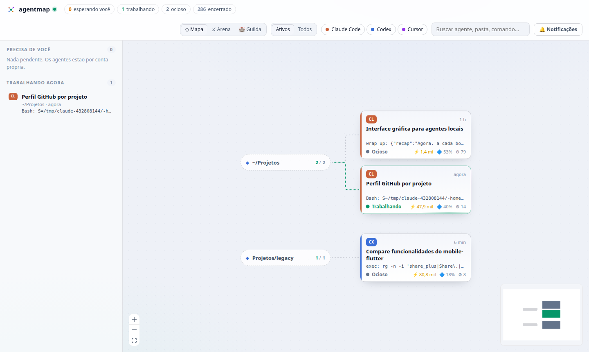
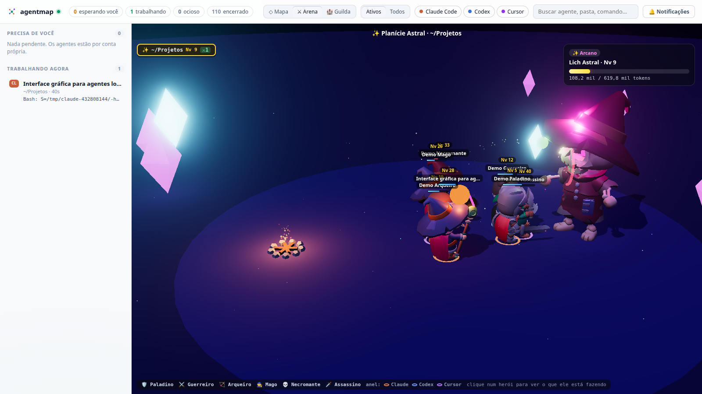
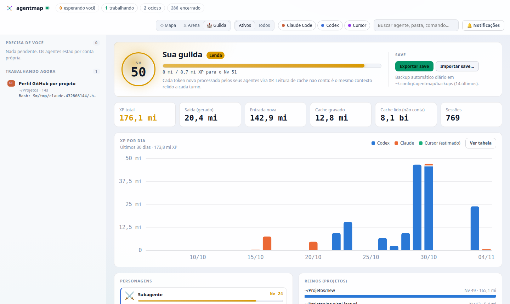

# agentmap

Mapa local, em tempo real, dos agentes de IA rodando na sua máquina: **Claude Code**, **Codex** e **Cursor**, com seus subagentes. Mostra o que cada um está fazendo e deixa você **aprovar ou negar** pedidos de permissão do Claude Code pela interface.

Tudo roda localmente: o daemon só escuta em `127.0.0.1`, lê arquivos que as próprias ferramentas já gravam em disco e não fala com nenhum serviço externo. Fontes, ícones e bibliotecas ficam todos no pacote, sem CDN.



## Uso

```bash
npm install
npm run build
npm start          # http://127.0.0.1:4317
```

Desenvolvimento (daemon com reload + Vite em http://127.0.0.1:5173):

```bash
npm run dev
```

Variáveis de ambiente:

| Variável | Padrão | O que faz |
|---|---|---|
| `AGENTMAP_PORT` | `4317` | porta do daemon |
| `AGENTMAP_WINDOW_HOURS` | `24` | só carrega sessões com atividade nessa janela |
| `AGENTMAP_APPROVAL_TIMEOUT` | `300` | segundos que o hook espera por uma decisão na UI |

## Arena (modo RPG)

Clique em **⚔ Arena** na barra superior. Cada projeto (pasta onde a sessão começou) vira um **reino** com cenário, clima e boss próprios: Floresta Esmeralda, Masmorra Sombria, Dunas de Âmbar, Picos Congelados, Caldeira Ardente ou Planície Astral. O cenário é sorteado a partir do projeto e do nível do boss: **a cada boss derrotado, os heróis viajam para um cenário novo** (nunca o mesmo da vez anterior), com outro clima e outro boss. Como o sorteio é derivado do projeto + nível, ele é o mesmo depois de recarregar a página ou em outra máquina.



A classe vem da **função** do agente; a ferramenta aparece no anel colorido sob os pés (laranja = Claude, azul = Codex, roxo = Cursor).

| Classe | Quem vira | Ataque |
|---|---|---|
| 🛡️ Paladino | orquestradores, tech leads, gestores de entrega/projeto; sessão principal do Codex | espada + luz sagrada; bloqueia golpes com o escudo |
| ⚔️ Guerreiro | desenvolvedores (backend, frontend, worker…) e papéis desconhecidos | machado de duas mãos, golpe giratório |
| 🏹 Arqueiro | pesquisadores e exploradores; sessão principal do Cursor | virotes de besta |
| 🧙 Mago | planejadores e arquitetos; sessão principal do Claude | bola de fogo |
| 💀 Necromante | QA e testes | orbe sombrio, invocação |
| 🗡️ Assassino | revisores, segurança, auditoria | avanço + golpe duplo (às vezes crítico); esquiva |

As regras ficam em `web/src/classes.ts`. Abra `http://127.0.0.1:4317/?demo` para ver um herói de cada classe lutando.

- **Trabalhando:** vai até o boss e ataca. Cada ferramenta usada vira um golpe com o nome dela (`Bash -7`).
- **Erro numa ferramenta:** o boss contra-ataca o herói.
- **Esperando você:** volta para a retaguarda com um balão **!** e um anel dourado. Clique no herói para aprovar.
- **Ocioso:** descansa na fogueira. **Encerrado:** dorme (zZ) num canto; os excedentes ficam "na taverna".
- **Boss = o projeto.** O nível do boss é o nível do reino (XP de todo o histórico do projeto), e a vida dele é o XP que falta para o projeto subir de nível. Quando o projeto sobe: **VITÓRIA!**, e surge o boss do nível seguinte.
- **Dano real:** cada token novo de uma sessão vira dano no boss (`browser_batch -844`). Entre um ganho e outro, os heróis seguem atacando, mas esses golpes mostram só a ferramenta, sem número.
- **Mana = janela de contexto da sessão.** A barra sob os pés do herói esvazia conforme o contexto enche (Codex: limite exato informado pelo próprio Codex; Claude: limite estimado, 200 mil ou 1 milhão conforme o uso já visto). Abaixo de 20% ela fica vermelha e piscando, e o herói ofega ("ufa…"). Quando a sessão é compactada e a mana volta, o herói **medita**. O mesmo dado aparece como "🔷 %" nos cards do mapa e no painel do agente.
- **O boss ataca** com os poderes do seu elemento (veja a tabela abaixo). Quanto maior o nível do projeto, mais rápido ele ataca.

### Engine e modelos

A Arena roda em **Three.js** (3D com luz e sombras dinâmicas, neblina, bloom e partículas), carregado só quando a Arena é aberta. Os personagens são modelos 3D animados do **KayKit** (Kay Lousberg, licença CC0), guardados em `web/public/models/kaykit/` e servidos localmente:

| Classe | Modelo | Algumas animações |
|---|---|---|
| Paladino | Knight (espada + escudo) | golpes de espada, bloqueio |
| Guerreiro | Barbarian (machado de duas mãos) | golpe giratório, corte, investida |
| Arqueiro | Rogue (besta) | mirar, atirar, recarregar |
| Mago | Mage (cajado) | conjurar e disparar bola de fogo |
| Necromante | Skeleton_Mage (cajado de caveira) | orbe sombrio, invocação |
| Assassino | Rogue_Hooded (duas facas) | avanço correndo, golpe duplo, esquiva |

- **Ocioso:** senta no chão em volta da fogueira e levanta quando volta a trabalhar.
- **Encerrado:** deita para dormir (zZ).
- **Golpe do boss:** o herói cambaleia; o paladino bloqueia e o assassino esquiva.
- **Level up:** o herói comemora.
- **Bosses:** esqueletos gigantes do KayKit, com arma, cor e olhos próprios de cada reino. Quando derrotado, o boss desmorona numa pilha de ossos, e o próximo se ergue do chão no cenário novo.

### Elementos dos bosses

Cada boss tem um elemento com dois ataques próprios, e os golpes deixam efeitos de status nos heróis:

| Boss | Elemento | Ataques | Efeito |
|---|---|---|---|
| Rei Esqueleto do Bosque | 🌿 Natureza | Raízes Espinhosas · Esporos Venenosos | enraizado (preso) · envenenado |
| Sombra da Masmorra | 🌑 Sombra | Rajada Sombria · Véu das Trevas (a arena escurece) | amaldiçoado |
| Faraó Esquecido | 🪨 Terra | Tempestade de Areia (tornado) · Terremoto | cegado · atordoado |
| Rei do Inverno | ❄️ Gelo | Chuva de Estalactites · Nova Congelante | congelado (bloco de gelo, animação parada) |
| Senhor das Brasas | 🔥 Fogo | Chuva de Meteoros · Erupção | queimando |
| Lich Astral | ✨ Arcano | Corrente Arcana (salta entre heróis) · Singularidade (puxa e explode) | corrompido · atordoado |

Enquanto dura o efeito, o herói não ataca. O paladino ainda pode bloquear e o assassino esquivar, e nesse caso não sofrem o efeito.

## Progressão e níveis

**XP = tokens novos** processados pelos agentes: entrada + saída + cache gravado. A leitura de cache não conta, porque é o mesmo contexto relido a cada turno (ela aparece nas estatísticas, mas não vira XP). O Cursor não grava tokens, então o XP dele é estimado (~4 caracteres por token) e aparece com "≈".

- **Curva:** XP acumulado para o nível N = 10.000 × (N−1)^2,5. Exemplos: Nv 10 ≈ 2,4 mi, Nv 20 ≈ 15,7 mi, Nv 30 ≈ 45 mi, Nv 50 ≈ 168 mi.
- **Personagem** = ferramenta + papel (`claude:main`, `codex:code_reviewer`…). O nível dele soma todas as sessões, de todo o histórico.
- **Guilda** (botão 🏰 Guilda): nível geral, XP por dia, personagens, reinos (projetos) e totais de tokens.
- Na Arena, cada herói mostra o nível do personagem e comemora com **LEVEL UP!** quando sobe.



O daemon lê todo o histórico uma vez (cerca de 8 s para 1,5 GB) e guarda o progresso em `~/.config/agentmap/ledger.json`. Depois disso, só as linhas novas são processadas. Sessões cujas transcrições foram apagadas continuam contando.

## Save e backup

O XP vive num **save portátil**: um JSON com os tokens de cada sessão, por dia, personagem e projeto.

- **Exportar / importar** pela Guilda, ou pela linha de comando (com o daemon rodando):
  ```bash
  npm run save:export -- meu-save.json
  npm run save:import -- meu-save.json
  ```
- Importar **mescla** os dados: uma sessão já conhecida não é contada de novo, então dá para importar o mesmo save várias vezes ou juntar máquinas diferentes.
- **Backup automático** diário em `~/.config/agentmap/backups/` (guarda os 14 mais recentes).

Para levar para outra máquina: exporte aqui, instale o agentmap lá, rode `npm start` e importe o arquivo.

## Aprovações do Claude Code

```bash
npm run hook:install     # adiciona o hook PermissionRequest em ~/.claude/settings.json
npm run hook:uninstall   # remove
```

O instalador salva uma cópia em `~/.claude/settings.json.agentmap-bak`. Sessões já abertas precisam ser reiniciadas.

Como funciona: quando o Claude precisa de permissão, o hook (`hooks/claude-permission.mjs`) envia o pedido ao daemon, que o mostra em **Precisa de você**. Você escolhe **Permitir**, **Sempre** (salva a regra sugerida pelo Claude), **Negar…** (com uma instrução opcional para o agente) ou **Responder no terminal**.

Se o agentmap não estiver rodando, não houver aba aberta ou o tempo acabar, o hook sai sem resposta e o Claude pergunta no terminal como de costume. O hook se autentica com um token em `~/.config/agentmap/token` (permissão 0600).

## De onde vêm os dados

| Ferramenta | Fonte | Observações |
|---|---|---|
| Claude Code | `~/.claude/sessions/<pid>.json` (sessões vivas + status), `~/.claude/projects/*/<sessão>.jsonl` e `…/<sessão>/subagents/agent-*.jsonl` | o status vem do próprio Claude; subagentes são ligados ao pai pelo `toolUseId` |
| Codex | `~/.codex/sessions/AAAA/MM/DD/rollout-*.jsonl`, `~/.codex/session_index.jsonl`; para o XP, também `~/.codex/archived_sessions/*.jsonl.zst` | subagentes têm `parent_thread_id`; perguntas (`request_user_input`) aparecem como "esperando você" |
| Cursor | `~/.cursor/projects/*/agent-transcripts/<id>/<id>.jsonl` | sem timestamps por linha; atividade estimada pelo mtime do arquivo |

Esses formatos são internos e mudam entre versões. Cada fornecedor fica isolado em `daemon/src/collectors/`.

## Arquitetura

```
daemon/src/
  main.ts          HTTP + WebSocket (/ws), endpoint do hook, arquivos estáticos
  store.ts         modelo normalizado, derivação de status, aprovações pendentes
  jsonl.ts         leitura incremental de JSONL (só as linhas novas)
  ledger.ts        XP: contagem de tokens de todo o histórico, save portátil e backups
  collectors/      claude.ts, codex.ts, cursor.ts
  types.ts         tipos compartilhados com a UI
hooks/             hook PermissionRequest do Claude Code
scripts/           instalador do hook, exportar/importar save
web/src/           React + React Flow (mapa, caixa de entrada, painel de detalhes, Guilda)
web/src/arena/     componente React da Arena (reinos, abas, legenda)
web/src/arena3d/   Arena 3D em Three.js: modelos KayKit, reinos, efeitos e combate
web/public/models/ modelos KayKit (CC0)
```

O daemon roda TypeScript direto pelo Node 22.18+ (type stripping), sem etapa de build.

## Limitações atuais

- Responder perguntas e enviar mensagens a agentes já abertos ainda não é suportado. Para o Claude, o painel oferece o comando `claude --resume <id>`.
- Aprovações do Codex e do Cursor não passam pelo agentmap; o status "esperando você" do Codex aparece, mas a resposta é dada no próprio app.

## Próximos passos possíveis

- Lançar agentes pela UI com o Claude Agent SDK ou `codex exec` e conversar com eles (com controle total de permissão).
- ACP (Agent Client Protocol) como camada única de interação.
- Notificações nativas do sistema via Tauri/Electron.
